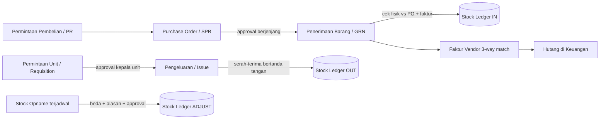

# Audit Sistem Logistik SIMAK vs Sistem Ideal

> Diperiksa read-only pada 5 Nov 2026: kode `backend/logistik/*`, `frontend/.../Logistik.jsx`, dan data riil di DB `rssams` (tabel legacy). **Tidak ada data yang diubah.**

## 1. Ringkasan satu paragraf

Akar masalahnya bukan satu bug, tapi **fondasi**: SIMAK hanya "mengecat ulang" tampilan di atas tabel legacy `app_siaga` tanpa merapikan modelnya. Tabel tidak punya kunci unik, stok disimpan sebagai angka yang bisa ditimpa, "stock opname" disamarkan jadi transaksi pembelian palsu, dan master barang hampir tidak terklasifikasi. Hasilnya angka stok tidak bisa dipercaya dan tidak bisa diaudit.

---

## 2. Temuan (diurutkan dari paling fatal)

### 🔴 Kritis: integritas data & stok

| # | Temuan | Bukti dari data |
|---|---|---|
| 1 | **Stok negatif** | 37 barang aktif stok minus. Contoh: FORM. OPERASI OK **-6.346**, MATERAI 10.000 **-2.939**, PLASTIK KLIP 8.7X13 **-1.964** |
| 2 | **Stok tersimpan ≠ hitungan transaksi** | Banyak barang tersimpan `0` padahal pengeluaran > penerimaan (AMPLOP RONTGEN: masuk 0, keluar 1.710, tersimpan 0). STICKER ANGKA tersimpan 300.000, keluar 43.800 |
| 3 | **Tabel pembelian tanpa Primary Key** | `tran_beli_brg_log` tidak punya PK/unique. Sudah terjadi **ID ganda `260001`** (INDO GROSIR & DEPO ISI ULANG) |
| 4 | **Opname disamarkan jadi pembelian palsu** | 51 header "pembelian" dengan rekanan `STOCK OPNAME` bernilai 0 + 14 header pengeluaran "STOCK OPNAME". Tabel transaksi bercampur dengan koreksi |
| 5 | **Opname menghapus ribuan unit tanpa jejak nilai** | Total selisih opname **-151.470 unit**. Contoh: BP DTS 5020 dari 92.898 jadi 8; FORM. RANAP -15.651 jadi 150. Kolom `harga` = 0 di 59 dari 112 opname, jadi kerugian tidak bisa dinilai rupiah. 5 barang di-opname 2x di hari yang sama |
| 6 | **Stok opname lalu tertimpa lagi** | FORM. OPERASI OK: baseline opname 60, stok sekarang -6.346 (rumus baseline+delta tidak konsisten) |
| 7 | **Header ≠ rincian** | 45 pembelian nilai header tidak sama dengan jumlah item. 2026: KANTOR POS 260036 header Rp250 rb vs item Rp6,25 jt; DEPO ISI ULANG header Rp10 rb vs item Rp2,36 jt |
| 8 | **Yatim data** | 11 header tanpa item, 3 item tanpa header, 64 pengeluaran menunjuk barang yang tidak ada, 33 menunjuk ruangan yang tidak ada |
| 9 | **Barang "dihapus" masih punya riwayat** | 202 barang `del='Y'`; **4.226** baris pengeluaran dan 42 baris pembelian masih mengarah ke barang terhapus |
| 10 | **Batch/FIFO praktis tidak berjalan** | **13.319 dari 13.329** pengeluaran tidak terhubung ke batch pembelian (`id_item_logistik` kosong) dan `harga = 0` di semua pengeluaran. Artinya **nilai pemakaian barang tidak pernah terhitung**, dan `jml_mutasi` batch tidak sinkron (10 batch selisih, 4 batch terisi tanpa pengeluaran) |

### 🟠 Tinggi: master data berantakan

| # | Temuan | Bukti |
|---|---|---|
| 11 | **Kode material & golongan hampir kosong** | 647 dari 648 barang aktif tanpa `kode_material`; 645 tanpa `gol_baru`. Fitur klasifikasi baru praktis baru terisi 3 barang |
| 12 | **Satuan & kemasan redundan dan tidak baku** | `BIJI` ada 242 barang; satuan `"1"`, `PCS` vs `BUAH` vs `BIJI` (arti sama), `Dozen` vs `DOZEN`, kemasan `JRIGEN` vs `JERIGEN` |
| 13 | **Faktor isi tidak valid** | 9 barang `isi ≤ 0`; 15 baris pembelian `isi ≤ 0`; 12 baris `qty ≤ 0`; 53 baris `harga ≤ 0` |
| 14 | **Barang kembar** | CELANA OK (468/469), ISI ULANG FREON R-32 (432/433), LAMPU LED PHILLIPS 8 WATT (183/508), SABUN CAIR (135/339) |
| 15 | **Vendor disimpan sebagai teks bebas** | `rekanan` di transaksi berupa nama ketik manual. **61 dari 63** nama vendor tidak cocok persis dengan master rekanan; varian ejaan: INDO GROSIR / INDOGROSIR / IDOGROSIR |
| 16 | **Tipe data longgar** | `item_out_log.qty` bertipe `decimal(10,0)` (tidak bisa pecahan), `item_logistik.qty` `decimal(10,2)`, `opname.real_stock` `int`. Tidak konsisten antar tabel |

### 🟡 Sedang: proses & permintaan unit

| # | Temuan | Bukti |
|---|---|---|
| 17 | **Permintaan menggantung** | 237 permintaan "Belum Ditanggapi"; **213** lebih dari 30 hari, ada yang sejak **2020**. 111 di antaranya meminta lebih banyak dari stok |
| 18 | **Tidak ada jejak verifikasi** | `tgl_verif` NULL di **13.088 dari 13.088** pengeluaran. Siapa yang menyetujui dan kapan tidak tercatat |
| 19 | **Pengeluaran tanpa header** | 13.319 baris `item_out_log` tanpa baris `tran_out_brg_log` (hanya 14 header). Tidak ada dokumen bukti serah-terima |
| 20 | **Qty keluar > qty diminta** | 17 baris `qty > qty_minta`; 19 baris status "Sudah Diberikan" dengan `qty = 0` |
| 21 | **Enum status mati** | `Disetujui Tapi Stock Masih Kosong` / `Disetujui` tak pernah dipakai; alur sebenarnya cuma 2 status |

### 🔵 Arsitektur & kode

| # | Temuan |
|---|---|
| 22 | **Dua model data paralel.** Django models (`LogistikBarang`, `LogistikBatch`, dll.) **kosong total & mati**, sementara semua logika memakai raw SQL ke `rssams.*`. Dua sumber kebenaran, salah satunya palsu |
| 23 | **`views.py` 3.571 baris** satu file, 11+ ViewSet, rumus stok didefinisikan **dua kali** (`legacy_stock` dan `_legacy_stock_ungated` dengan hasil beda) |
| 24 | **Skema diubah saat runtime.** `ensure_workflow_schema()` menjalankan `ALTER TABLE` dari dalam request |
| 25 | **ID dibuat dengan `MAX()+1`** (8 titik) tanpa lock/`select_for_update`. Ruang ID pembelian & SPB dipakai bersama; risiko ID kembar saat 2 user simpan bersamaan. Ini sudah terbukti di temuan #3 |
| 26 | **Hampir tanpa transaksi atomik.** Hanya 3 `transaction.atomic` di 3.571 baris. Gagal di tengah proses = data setengah jadi |
| 27 | **Stok dihitung ulang tiap request lalu ditimpa** ke kolom `stock`, bukan diturunkan dari buku besar. Satu jalan yang salah menimpa kebenaran |
| 28 | **Penghapusan barang cuma `del='Y'`** tanpa cek stok/riwayat; bulk delete hanya dibatasi role, tanpa alasan, tanpa log siapa yang menghapus |
| 29 | **Hapus pembelian = `DELETE` fisik** (Draft) dan hapus item batch juga fisik. Tidak ada audit trail |
| 30 | **Nama ID bertabrakan dengan modul lain.** Nomor SPB logistik (`26xxxx`) berbentuk sama dengan nomor SPB farmasi (mis. 260809). Saat dicocokkan lewat `nomor_spb`, 189 baris utang farmasi & 12 manual ikut cocok. Rawan salah-sambung ke Keuangan |
| 31 | **Flag `kirim_keuangan` hanya formalitas**: default `'Y'`, tidak pernah diubah kode mana pun, jadi tidak ada kontrol sebenarnya |

> [!NOTE]
> Masih perlu dikonfirmasi: apakah `app_siaga` lama masih dipakai menulis ke tabel yang sama. Kalau ya, ada dua aplikasi menulis ke data yang sama dengan aturan berbeda, dan itu bisa menjelaskan sebagian anomali (stok tertimpa, ID kembar).

---

## 3. Bagaimana sistem ideal di perusahaan/RS pada umumnya

### Prinsip inti (yang dipakai ERP/WMS/SIMRS mana pun)

1. **Stok tidak pernah diketik atau ditimpa. Stok = hasil penjumlahan buku besar (stock ledger).**
   Setiap perubahan adalah satu baris *immutable* (`IN`, `OUT`, `ADJUST`, `TRANSFER`) dengan tanggal, user, dokumen sumber, dan nilai. Saldo = `SUM(ledger)`. Koreksi dilakukan dengan baris baru, bukan edit.
2. **Setiap pergerakan punya dokumen sumber.** Masuk = GRN/Penerimaan, keluar = Bukti Pengeluaran/Mutasi, koreksi = Berita Acara Opname.
3. **Pisahkan dokumen.** Pembelian, penerimaan, pengeluaran, dan opname adalah dokumen berbeda, tidak boleh meminjam tabel satu sama lain.
4. **Master data baku & terkunci.** Kode unik, golongan, satuan dari daftar resmi, vendor dari master (bukan teks bebas).
5. **Segregation of duties.** Yang membuat ≠ yang menyetujui ≠ yang menerima barang ≠ yang menghitung opname.
6. **Audit trail menyeluruh.** Tidak ada hard delete pada data transaksi; hanya *void/cancel* dengan alasan dan pelaku.

### Alur yang ideal (Procure-to-Pay + Inventory)

### Tabel perbandingan: sekarang vs ideal

| Aspek | Kondisi sekarang | Standar ideal |
|---|---|---|
| Stok | Kolom `stock` ditimpa | Dihitung dari ledger, tidak bisa diedit |
| Stok minus | Diizinkan (37 barang) | Diblokir, atau hanya lewat adjustment ber-approval |
| Kunci data | Tabel tanpa PK, `MAX()+1` | PK/UNIQUE + sequence ber-lock per jenis dokumen |
| Penomoran | `YYNNNN` bersama lintas modul | Prefix per dokumen: `PO-`, `GRN-`, `ISS-`, `ADJ-` + tahun + urut |
| Opname | Header pembelian palsu | Dokumen opname sendiri: stok sistem, hitung fisik, selisih, nilai Rp, alasan, approver |
| Nilai persediaan | `harga=0` di pengeluaran | Metode baku (FIFO/Moving Average), tiap OUT bernilai |
| Master barang | 647/648 tanpa kode | Kode wajib & unik, golongan wajib, satuan dari daftar |
| Satuan | Teks bebas + kemasan redundan | Satuan dasar (UoM) + tabel konversi (box → pcs) |
| Vendor | Nama diketik | FK ke master vendor |
| Penghapusan | `del='Y'` / `DELETE` | Nonaktif (arsip) bila ada riwayat; transaksi hanya void + alasan |
| Permintaan unit | Menggantung bertahun-tahun | SLA (mis. 3 hari), auto-expire/eskalasi, status lengkap |
| Verifikasi | Tidak tercatat | Siapa, kapan, catatan; tanda tangan serah-terima |
| Min/Max & reorder | `stok_minimum` saja | Min/Max + titik pesan ulang + saran pembelian otomatis |
| 3-way match | Tidak ada | PO ↔ Penerimaan ↔ Faktur dicocokkan sebelum jadi hutang |
| Laporan | Ada dasar | Kartu stok, nilai persediaan, slow/dead stock, shrinkage, pemakaian per unit |

---

## 4. Rekomendasi bertahap (supaya tidak "rebuild total")

**Fase 0: Stop pendarahan (1-2 hari, risiko rendah)**
- Pasang **PRIMARY KEY** pada `tran_beli_brg_log`, bereskan ID `260001` ganda dulu.
- Larang stok minus pada pengeluaran (sudah ada cek `stock < qty`, pastikan semua jalur lewat situ).
- Satu rumus stok saja (hapus `_legacy_stock_ungated`), dan pindahkan `ALTER TABLE` ke migrasi.
- Pastikan `app_siaga` lama **read-only** untuk logistik.

**Fase 1: Bersihkan master data (1-2 minggu)**
- Normalisasi satuan/kemasan (daftar baku), perbaiki `isi ≤ 0`, gabungkan 4 barang kembar.
- Isi `kode_material` + golongan untuk 648 barang aktif (bisa auto-generate lalu direview petugas gudang).
- Petakan vendor teks bebas ke master rekanan.

**Fase 2: Ledger stok (2-4 minggu)**
- Buat tabel `stock_ledger` tunggal; isi **saldo awal** dari opname terakhir yang sah (buang jejak header "STOCK OPNAME" palsu dari tabel pembelian).
- Stok = `SUM(ledger)`; kolom `stock` jadi cache turunan saja.
- Dokumen opname sendiri dengan nilai Rp dan approval.

**Fase 3: Proses & kontrol (berikutnya)**
- Permintaan unit: SLA + eskalasi, catat `tgl_verif`/verifikator, bukti serah-terima.
- Nilai persediaan (FIFO/rata-rata) dan 3-way match PO ↔ penerimaan ↔ faktur.
- Hapus model Django mati, pecah `views.py` per domain, bungkus operasi dalam `transaction.atomic`.

> [!IMPORTANT]
> Sebelum Fase 2, **keputusan bisnis** dibutuhkan: (a) tanggal cut-off saldo awal yang sah, (b) apakah selisih opname −151.470 unit itu benar-benar hilang atau akibat data masuk yang tidak pernah diinput. Angkanya terlalu besar untuk dianggap kerugian nyata tanpa verifikasi fisik.

> [!NOTE]
> Semua angka di atas berasal dari query langsung ke DB saat audit; skrip ada di folder scratch dan bersifat read-only.
