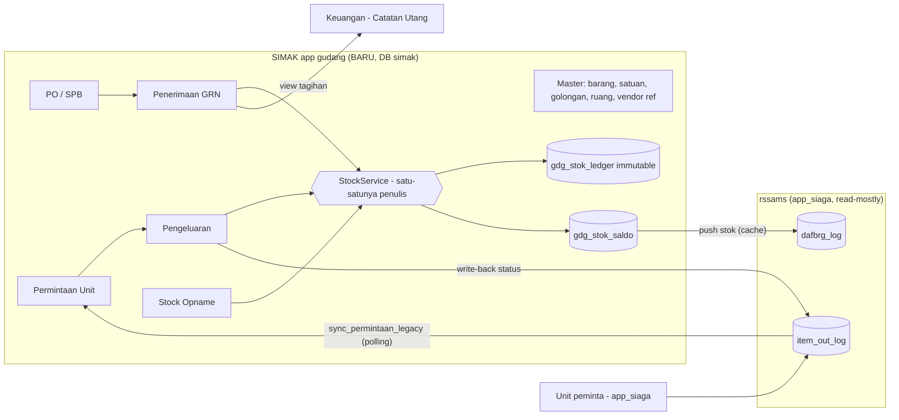
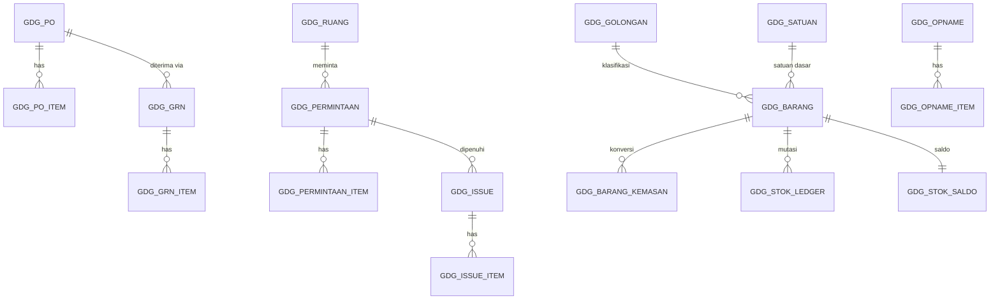

# RANCANGAN: Gudang Logistik SIMAK v2 (Bangun Ulang Inti)

> **Dokumen ini mandiri.** Model/agen mana pun bisa melanjutkan eksekusi hanya dari dokumen ini + repo. Salinan ada di `docs/gudang/RANCANGAN.md`. Progres dicatat di `docs/gudang/PROGRESS.md`.
> Tanggal rancangan: 5 Nov 2026. Bahasa komunikasi dengan user: Indonesia santai (`bro/gua/lu`).

---

## 0. Keputusan: Rombak atau Bangun Ulang?

**Keputusan: BANGUN ULANG INTI (app Django baru `gudang`), bukan rombak `logistik`.** Strategi *strangler*: sistem baru berdiri berdampingan, sistem lama dibekukan jadi arsip read-only.

| Kriteria | Rombak `logistik` | Bangun ulang `gudang` |
|---|---|---|
| Fondasi data | Harus bongkar tabel legacy tanpa PK saat sistem berjalan | Tabel baru bersih, dikelola migrasi Django |
| Kode | 3.571 baris raw SQL, 2 rumus stok, ALTER TABLE saat request | Service layer tunggal, teruji |
| Risiko saat transisi | Tinggi (live, 1 salah = stok rusak) | Rendah (lama tetap jalan sampai cut-over) |
| Stok | Sulit dipercaya, harus di-patch terus | Dimulai dari **hitung fisik** (saldo awal bersih) |
| Biaya | Tampak murah, tapi tiap fix memunculkan anomali baru | Lebih besar di awal, jauh lebih murah setelahnya |
| **Dipakai ulang dari sistem lama** | - | Pola UI (`inv-*` CSS, `Modal`), hierarki approval (`User.get_approvers_chain`), master `users.Unit`, util PDF SPB, kontrak ke Keuangan |

**Yang dibuang:** tabel `rssams.tran_beli_brg_log`, `item_logistik`, `item_out_log` (tetap ada sebagai arsip), model Django `logistik` yang kosong, semua `MAX()+1`.

> [!IMPORTANT]
> Riwayat stok lama **tidak dimasukkan ke ledger baru**. Saldo awal diambil dari **stock opname fisik** pada hari cut-over. Alasannya: data lama memuat stok minus, opname -151.470 unit yang belum terverifikasi, dan ID ganda; memasukkannya ke ledger akan mewariskan semua kerusakan itu.
> **Namun riwayat lama tetap bisa dipakai sebagai data tampilan:** daftar barang lama (dengan `legacy_id_brg`) dan jejak keluar-masuknya disalin read-only ke `gdg_legacy_mutasi` dan tampil di tab "Riwayat Lama" pada Kartu Stok (keputusan user 5 Nov 2026, lihat §10.1).

---

## 1. Konteks & Fakta yang Sudah Terverifikasi

Sumber: audit 5 Nov 2026 (`audit_sistem_logistik.md`).

1. **Petugas logistik** sudah cut-off dari `app_siaga` per 4 Nov 2026 (kini memakai modul `logistik` lama di SIMAK). **Unit peminta barang masih memakai `app_siaga`** (form permintaan).
2. Permintaan unit di `app_siaga` tertulis di `rssams.item_out_log`: **ID format `YY-NNNNNN`** (9 karakter, 1 baris per barang, `status='Belum Ditanggapi'`, `id_ruang` dari `rssams.kode_ruang`). Baris dengan ID `YYNNNN-1` (8 karakter) adalah **pengeluaran buatan SIMAK/opname**, **bukan** permintaan unit.
3. Ruang di `app_siaga`: **48 ruang** (`rssams.kode_ruang`, mis. Poli Gigi, IGD, Apotik, IPSRS). SIMAK hanya punya **18 `users.Unit`** (lebih kasar). Perlu tabel pemetaan.
4. User SIMAK aktif hanya **24 orang** (4 `is_logistik`, 3 `view_logistik`). Staf unit di `app_siaga` **sebagian besar belum punya akun SIMAK**.
5. Keuangan membaca pembelian logistik **langsung dari `rssams.tran_beli_brg_log`** (`done='Y'`, join teks `rssams.rekanan.nama`, kecualikan `rekanan='STOCK OPNAME'` dan `no_spk LIKE 'OPNAME-%'`) di `backend/keuangan/views.py` sekitar baris **4359** (`_build_pending_where_logistik`), **5633-5649** (auto-list), **7881** (`kirim_gate`). Dedupe utang memakai `keuangan_utang_supplier.app_siaga_faktur_id = 'LOG-<id>'` dan `nomor_spb`.
6. Nomor SPB logistik (`26xxxx`) **bertabrakan bentuk** dengan nomor SPB farmasi (mis. 260809). Nomor baru wajib berprefix.
7. ⚠️ **DB yang dipakai di laptop dev adalah salinan Docker (`127.0.0.1`), datanya berhenti 28 Okt 2026.** Data live ada di server `192.168.44.116`. Angka audit harus **diulang di data live** sebelum migrasi (Fase 0).
8. Stack: Django + DRF + JWT, MySQL, React (Vite) di `frontend/`, `AUTH_USER_MODEL = users.User`, role: `karyawan, kepala_seksi, manajer, wakil_direktur, direktur`, flag `is_logistik`, `view_logistik`.

---

## 2. Prinsip Desain (tidak boleh dilanggar)

1. **Stok = hasil penjumlahan ledger.** Tidak ada kode yang `UPDATE stock = ...`. Satu-satunya penulis ledger: `gudang.services.stock.StockService`.
2. **Ledger immutable.** Tidak ada UPDATE/DELETE. Koreksi = baris pembalik (*reversal*) baru.
3. **Stok tidak boleh minus.** Divalidasi di dalam transaksi dengan row lock.
4. **Satu dokumen = satu tujuan.** PO, Penerimaan (GRN), Permintaan, Pengeluaran, Opname adalah tabel terpisah. Tidak ada "pembelian palsu" untuk opname.
5. **Dokumen yang sudah diajukan/diposting tidak bisa diedit atau dihapus.** Hanya *void* dengan alasan wajib.
6. **Hard delete hanya untuk Draft.** Master yang punya riwayat hanya bisa *nonaktif*.
7. **Segregation of duties:** pembuat ≠ penyetuju (sudah ada pola `_approval_guard`). Penghitung opname ≠ penyetuju opname.
8. **Setiap mutasi tercatat di audit log** (siapa, kapan, sebelum/sesudah).
9. **Semua nomor dokumen dari tabel urut ber-lock**, berprefix per jenis.
10. **Semua operasi tulis memakai `transaction.atomic`.**
11. **Tidak ada DDL (`ALTER TABLE`) dari dalam request.** Skema hanya via migrasi Django.
12. **File maksimal ±600 baris.** Dilarang mengulang pola `views.py` 3.500 baris.

---

## 3. Arsitektur



- **Lokasi tabel:** schema `simak` (default DB Django), prefix `gdg_`. **Bukan** di `rssams`.
- **Struktur kode backend** `backend/gudang/`:
  ```
  models/        barang.py, dokumen_beli.py, permintaan.py, opname.py, ledger.py, setting.py, audit.py
  services/      stock.py, numbering.py, approval.py, bridge_legacy.py, keuangan.py
  serializers/   per domain
  views/         per domain (maks ±400 baris)
  management/commands/  import_master_legacy.py, sync_permintaan_legacy.py,
                        gudang_reconcile.py, expire_permintaan.py, push_legacy_stock.py
  tests/
  urls.py, apps.py, admin.py
  ```
- **Struktur frontend** `frontend/src/pages/Gudang/`: satu file per halaman (lihat §8). Route `/gudang/*`.

---

## 4. Model Data

> Tipe: kuantitas `Decimal(14,3)`; harga `Decimal(15,4)`; nilai `Decimal(18,2)`. Semua tabel punya `created_at`, `updated_at`; dokumen punya `created_by`.



### 4.1 Master

| Tabel | Kolom penting | Catatan |
|---|---|---|
| `gdg_golongan` | `kode` (unik, mis. `B1`), `nama`, `prefix_kode` | Seed dari `B1 - ATK`, `B2 - BHP Kantor & Cetakan`, `B8 - Lainnya`, dst. (lihat `GOLONGAN_OPTIONS` di `Logistik.jsx`) |
| `gdg_satuan` | `kode` (unik, UPPER), `nama` | Daftar baku: PCS, BOX, BTL, PAK, RIM, ROLL, LEMBAR, BUKU, SET, UNIT, LITER, KG, METER, DOZEN, SACHET, ZAK, IKAT, PASANG, KALENG, TUBE, JERIGEN |
| `gdg_barang` | `kode` **UNIQUE NOT NULL** (mis. `B1-0001`), `nama`, `golongan` FK, `satuan_dasar` FK, `merk`, `stok_minimum`, `stok_maksimum`, `lead_time_hari`, `is_active`, `legacy_id_brg` **UNIQUE NULL** | Nama unik per (nama, merk) dibandingkan setelah normalisasi (UPPER, trim, spasi tunggal) |
| `gdg_barang_kemasan` | `barang` FK, `nama_kemasan` (mis. BOX), `isi_per_kemasan` (dalam satuan dasar, > 0), `is_default_beli` | Menggantikan kolom `kemasan` + `isi` yang redundan |
| `gdg_ruang` | `kode`, `nama`, `unit` FK `users.Unit` null, `legacy_id_ruang` UNIQUE null, `is_active` | Seed dari 48 baris `rssams.kode_ruang` |
| `gdg_gudang` | `kode`, `nama`, `is_default` | Seed 1 baris: `GUDANG-UMUM`. Struktur sudah siap multi-gudang |
| `gdg_setting` | `kunci`, `nilai_json` | SLA permintaan, dll. (tanpa ambang approval) |
| `gdg_legacy_mutasi` | `legacy_id_brg`, `barang` FK null, `jenis` (`MASUK`/`KELUAR`/`OPNAME`), `tanggal`, `qty_dasar` (bertanda), `harga_dasar` null, `ruang_nama`, `vendor_nama`, `dokumen_legacy` (id asli), `catatan`, `sumber_tabel` | **Salinan read-only riwayat lama untuk tampilan.** Tidak pernah menyentuh ledger/saldo. Lihat §10.1 |

**Vendor:** jangan buat master baru. Pakai master yang sudah dipakai Keuangan (`rssams.rekanan`, `sumber='logistik'`). Simpan `vendor_id` (int, id_rekanan) + `vendor_nama` (snapshot). Wajib dipilih dari master, bukan diketik.

### 4.2 Pembelian

| Tabel | Kolom |
|---|---|
| `gdg_po` | `nomor` UNIQUE (`PO-2026-00001`), `tanggal`, `vendor_id`, `vendor_nama`, `status` (`draft, diajukan, disetujui, sebagian, selesai, batal`), `catatan`, `submitted_at`, `approved_by`, `approved_at`, `catatan_tolak`, `batal_alasan`, `batal_by`, `batal_at`, `created_by` |
| `gdg_po_item` | `po` FK, `barang` FK, `kemasan` FK null, `qty_pesan` (dalam kemasan), `isi_snapshot`, `harga_kemasan` |
| `gdg_grn` | `nomor` UNIQUE (`GRN-2026-00001`), `po` FK **null** (langsung tanpa PO diizinkan dengan `alasan_tanpa_po` wajib), `vendor_id`, `vendor_nama`, `no_faktur_vendor`, `tgl_faktur`, `tgl_terima`, `status` (`draft, diajukan, disetujui, batal`), `total_nilai`, `kirim_keuangan` (bool, default **True**), approval fields seperti PO, `created_by` |
| `gdg_grn_item` | `grn` FK, `po_item` FK null, `barang` FK, `kemasan` FK null, `qty_kemasan`, `isi_snapshot`, `qty_dasar` (= qty_kemasan × isi), `harga_kemasan`, `harga_dasar` (= harga_kemasan / isi), `subtotal`, `no_batch` null, `tgl_expired` null |

Aturan: `UNIQUE(grn, barang, kemasan)` di draft agar barang tidak ganda tanpa sengaja. `qty_dasar > 0`, `harga_dasar >= 0` (harga 0 butuh centang `gratis`/alasan).

### 4.3 Permintaan & Pengeluaran

| Tabel | Kolom |
|---|---|
| `gdg_permintaan` | `nomor` UNIQUE (`REQ-2026-00001`), `ruang` FK, `tanggal`, `status` (`diajukan, diproses, sebagian, selesai, ditolak, batal, kadaluarsa`; `draft` untuk input dari SIMAK), `sumber` (`simak`/`app_siaga`), `diminta_oleh` FK user null, `diminta_oleh_nama` (snapshot, wajib untuk bridge), `due_at` (SLA), `catatan` |
| `gdg_permintaan_item` | `permintaan` FK, `barang` FK, `qty_minta`, `qty_setuju` null, `qty_serah` default 0, `status` (`menunggu, disetujui, ditolak, selesai`), `alasan_tolak`, `legacy_item_out_id` UNIQUE null |
| `gdg_issue` | `nomor` UNIQUE (`ISS-2026-00001`), `permintaan` FK null (pengeluaran langsung diizinkan, alasan wajib), `ruang` FK, `tanggal`, `status` (`draft, posted, void`), `diserahkan_oleh` FK user, `diterima_oleh_nama` **wajib saat posted**, `bukti_foto` null, `catatan`, `void_alasan`, `void_by`, `void_at` |
| `gdg_issue_item` | `issue` FK, `permintaan_item` FK null, `barang` FK, `qty_dasar`, `nilai_unit` (diisi saat posting dari rata-rata), `nilai_total` |
| `gdg_bridge_map` | `legacy_item_out_id` UNIQUE, `permintaan_item` FK, `synced_at`, `writeback_status`, `writeback_at` |

### 4.4 Opname

| Tabel | Kolom |
|---|---|
| `gdg_opname` | `nomor` UNIQUE (`OPN-2026-00001`), `gudang` FK, `tanggal`, `jenis` (`berkala`, `saldo_awal`, `insidental`), `status` (`counting, diajukan, disetujui, batal`), `frozen_at`, `dibuat_oleh`, `disetujui_oleh`, `catatan` |
| `gdg_opname_item` | `opname` FK, `barang` FK, `qty_sistem` (snapshot saat `frozen_at`), `qty_fisik` null (belum dihitung), `selisih`, `nilai_unit`, `nilai_selisih`, `alasan` (**wajib jika selisih ≠ 0**), `dihitung_oleh` FK user, `dihitung_at` |

### 4.5 Ledger & Saldo (jantung sistem)

**`gdg_stok_ledger`** (append-only)

| Kolom | Keterangan |
|---|---|
| `id` BigAuto | |
| `gudang` FK, `barang` FK | |
| `tanggal_efektif` datetime | waktu kejadian bisnis |
| `jenis` | `IN`, `OUT`, `ADJ_PLUS`, `ADJ_MINUS`, `REV_IN`, `REV_OUT` |
| `qty_dasar` | **bertanda**: + masuk, − keluar |
| `nilai_unit` | harga rata-rata per satuan dasar pada saat itu |
| `nilai_total` | bertanda (qty × nilai_unit) |
| `saldo_qty_setelah`, `saldo_nilai_setelah` | snapshot running balance (mempermudah kartu stok & audit) |
| `sumber_tipe` | `GRN`, `ISS`, `OPN`, `VOID` |
| `sumber_id`, `sumber_nomor` | referensi dokumen |
| `reversal_of` FK self null | menunjuk baris yang dibalik |
| `keterangan`, `created_by`, `created_at` | |

Indeks: `(barang, gudang, tanggal_efektif, id)`, `(sumber_tipe, sumber_id)`.
**Guard:** override `save()`/`delete()` di model supaya UPDATE/DELETE melempar error, **dan** (disarankan) trigger MySQL `BEFORE UPDATE/DELETE` via `RunSQL` di migrasi.

**`gdg_stok_saldo`**: `UNIQUE(barang, gudang)`, `qty`, `nilai`, `avg_cost` (turunan), `updated_at`. Ini **cache turunan** yang diverifikasi terhadap ledger oleh `gudang_reconcile`.

### 4.6 Pendukung

- `gdg_nomor_seq`: `jenis`, `tahun`, `terakhir` (UNIQUE jenis+tahun). Penomoran: `select_for_update()` → +1 → format `PREFIX-YYYY-NNNNN`.
- `gdg_aktivitas` (audit log): `model`, `obj_id`, `aksi`, `user`, `sebelum_json`, `sesudah_json`, `created_at`. **Cek dulu** apakah app `system`/`AuditLog.jsx` sudah punya mekanisme audit yang bisa dipakai ulang; jika ada, pakai itu.

---

## 5. Aturan Bisnis

### 5.1 Penilaian persediaan: **Rata-rata Bergerak (Weighted Moving Average)**
- **IN:** `avg_baru = (saldo_nilai + qty×harga_dasar) / (saldo_qty + qty)`.
- **OUT:** `nilai_unit = avg_saat_ini`; `saldo_nilai -= qty × nilai_unit`.
- **ADJ_PLUS:** nilai = `avg_saat_ini` (bila saldo 0, pakai harga beli terakhir; bila tak ada, pakai nilai input opname, tak boleh kosong).
- **ADJ_MINUS:** nilai = `avg_saat_ini`.
- Jika `saldo_qty` menjadi 0 → paksa `saldo_nilai = 0` (menyerap pembulatan).
- Alasan memilih rata-rata, bukan FIFO: barang logistik umum (ATK, cetakan, RT), tidak ada expired, jauh lebih sederhana dan stabil. Struktur `no_batch/tgl_expired` disiapkan bila kelak dibutuhkan.

### 5.2 `StockService` (API internal, satu-satunya penulis)
```python
post_in(grn)            # dipanggil saat GRN disetujui
post_out(issue)         # dipanggil saat Issue diposting; validasi stok >= qty di dalam lock
post_adjust(opname)     # dipanggil saat Opname disetujui
void_document(doc, alasan, user)  # menulis REV_* untuk setiap baris ledger dokumen itu
get_saldo(barang, gudang)
```
Wajib: `transaction.atomic`, `select_for_update()` pada baris `gdg_stok_saldo` **diurutkan berdasarkan `barang_id`** (hindari deadlock), buat baris saldo bila belum ada. Gagal sebagian → rollback total.

### 5.3 Status & transisi

```mermaid
stateDiagram-v2
    [*] --> draft
    draft --> diajukan: submit
    diajukan --> disetujui: approve (bukan pembuat)
    diajukan --> draft: tolak (catatan wajib)
    disetujui --> batal: void (alasan wajib; reversal jika sudah posting)
    draft --> [*]: hapus (hanya Draft)
```


- **GRN disetujui → `post_in`.** Void GRN hanya boleh jika qty masih cukup di saldo; jika tidak, tampilkan pesan dan arahkan ke retur/adjustment.
- **Issue posted → `post_out`**; void Issue → `REV_OUT` (stok kembali).
- **Opname disetujui → `post_adjust`** untuk setiap baris selisih ≠ 0.
- **Permintaan:** `qty_serah` diakumulasi dari Issue; semua item selesai → `selesai`; sebagian → `sebagian`.

### 5.4 Approval (keputusan user 5 Nov 2026)
- **Penyetuju = siapa saja dengan role `kepala_seksi`, `manajer`, `wakil_direktur`, `direktur`, atau superuser.** Tidak ada batas nominal dan tidak ada rantai berjenjang.
- Pembuat dokumen ≠ penyetuju (melanggar → 403). Ini satu-satunya kontrol tambahan.
- Berlaku sama untuk PO, GRN, dan Opname (penghitung ≠ penyetuju). Selisih opname besar tetap **ditandai** di UI (badge) tetapi tidak membutuhkan level lebih tinggi.
- Implementasi: satu fungsi `can_approve(user, doc)` di `services/approval.py`. Tidak perlu `get_approvers_chain()`.

### 5.5 Permintaan unit
- **SLA:** `due_at = tanggal + 3 hari`. Lewat → badge merah. Lebih dari 14 hari belum diproses → command `expire_permintaan` menandai `kadaluarsa` (dengan log).
- Item yang diminta > stok tersedia tetap diterima sebagai permintaan, tapi UI gudang menandai "stok kurang"; Issue dibatasi sampai stok tersedia (tidak boleh minus).
- Penolakan item wajib `alasan_tolak`.

### 5.6 Validasi master
- `kode` unik; `nama+merk` unik (normalisasi); `satuan` hanya dari `gdg_satuan` (**bukan freetext**; lihat catatan di §13-Q1); `isi_per_kemasan > 0`.
- Barang yang punya riwayat ledger **tidak bisa dihapus**, hanya nonaktif. Menonaktifkan barang dengan stok > 0 → ditolak.

---

## 6. API (DRF, prefix `/api/gudang/`)

| Domain | Endpoint |
|---|---|
| Master | `GET/POST /barang/`, `GET/PATCH /barang/{id}/`, `POST /barang/{id}/nonaktif/`, `GET /barang/generate-kode/?golongan=`, CRUD `/satuan/`, `/golongan/`, `/ruang/`, `/barang/{id}/kemasan/` |
| Stok | `GET /stok/` (daftar saldo, filter di bawah minimum), `GET /stok/{barang}/kartu/?dari=&sampai=` |
| PO | `GET/POST /po/`, `GET/PATCH/DELETE(draft) /po/{id}/`, `POST /po/{id}/submit/`, `POST /po/{id}/approval/` (`setujui`/`tolak`), `POST /po/{id}/batal/` |
| GRN | `GET/POST /grn/` (bisa `?dari_po=`), `PATCH /grn/{id}/`, `POST /grn/{id}/submit/`, `POST /grn/{id}/approval/`, `POST /grn/{id}/void/` |
| Permintaan | `GET/POST /permintaan/`, `POST /permintaan/{id}/tolak-item/`, `POST /permintaan/{id}/batal/` |
| Issue | `GET/POST /issue/`, `POST /issue/{id}/post/`, `POST /issue/{id}/void/` |
| Opname | `GET/POST /opname/`, `POST /opname/{id}/freeze/`, `PATCH /opname/{id}/item/{item}/` (input hitung fisik), `POST /opname/{id}/submit/`, `POST /opname/{id}/approval/` |
| Laporan | `GET /laporan/nilai-persediaan/`, `/pemakaian-unit/`, `/slow-dead-stock/`, `/selisih-opname/`, `/reorder/` |
| Arsip legacy | `GET /arsip/pengeluaran/`, `/arsip/pembelian/` (read-only dari `rssams`) |
| Admin | `GET /health/reconcile/` (hasil rekonsiliasi saldo vs ledger) |

Semua endpoint: `IsAuthenticated` + permission turunan dari `is_logistik` / `view_logistik` / role. Pagination memakai pola yang sudah ada (`utils/pagination.jsx` di frontend; DRF pagination di backend). Pesan error berbahasa Indonesia.

---

## 7. Jembatan ke `app_siaga` (selama unit belum pindah)

Unit masih membuat permintaan di `app_siaga`. Jembatan **satu arah masuk + write-back terbatas**.

### 7.1 `sync_permintaan_legacy` (polling tiap 1-2 menit)
1. Ambil `rssams.item_out_log` dengan `status='Belum Ditanggapi'` **dan** ID cocok regex `^[0-9]{2}-[0-9]{6}$` (permintaan unit), **dan** belum ada di `gdg_bridge_map`.
2. Petakan `id_ruang` → `gdg_ruang.legacy_id_ruang`; `id_brg` → `gdg_barang.legacy_id_brg`. Jika barang/ruang tak ditemukan → catat ke tabel/log "unmapped", **jangan** hilang diam-diam.
3. Kelompokkan per `(ruang, tanggal)`: tempel ke `gdg_permintaan` terbuka (`sumber='app_siaga'`, status `diajukan`) bila ada, jika tidak buat baru. Isi `diminta_oleh_nama` dari data legacy jika tersedia, selain itu `"App Siaga - <nama ruang>"`.
4. Idempotent (UNIQUE `legacy_item_out_id`).

### 7.2 Write-back (agar unit melihat status di `app_siaga`)
Saat Issue diposting / item ditolak, dalam transaksi yang sama:
```sql
UPDATE rssams.item_out_log
SET status='Sudah Diberikan', qty=%s, tgl_verif=NOW()
WHERE id=%s AND status='Belum Ditanggapi';      -- tolak: status='Tidak Disetujui'
```
Catat hasil di `gdg_bridge_map.writeback_*`. Kegagalan write-back **tidak** membatalkan Issue; masuk antrean retry dan terlihat di halaman admin.

### 7.3 Push stok & master ke legacy (cache untuk pemilih barang di `app_siaga`)
- `push_legacy_stock`: tulis `gdg_stok_saldo.qty` ke `rssams.dafbrg_log.stock` untuk barang ber-`legacy_id_brg` (hanya cache tampilan).
- Pembuatan barang baru di sistem baru → opsional `push_legacy_master` agar bisa dipilih unit. **Pembuatan barang baru di `app_siaga` dibekukan** (komunikasikan ke user).

### 7.4 Rencana pensiun jembatan
Unit dipindah ke SIMAK dengan **akun bersama per ruang** (role `karyawan`, `unit`/ruang terisi, form "Minta Barang" yang sederhana), karena sebagian besar staf unit belum punya akun. Setelah semua ruang pindah → matikan `sync_permintaan_legacy`, set `app_siaga` modul permintaan read-only.

---

## 8. Frontend (`frontend/src/pages/Gudang/`)

Route di `App.jsx` (`/gudang/:section`), menu di `Layout.jsx` (grup "Gudang Logistik", ada di sekitar baris 150 dan 446; menu lama `/logistik/*` dipertahankan sampai sunset, lalu diarahkan ke `/gudang/*`).

| File | Isi |
|---|---|
| `GudangLayout.jsx` | Shell + tab/section |
| `Dashboard.jsx` | Kartu: stok di bawah minimum, permintaan menunggu/lewat SLA, GRN menunggu approval, nilai persediaan, selisih opname terakhir |
| `Barang.jsx` + `BarangForm.jsx` | Daftar & tambah/edit barang; **satuan dasar dari dropdown master**; kemasan sebagai sub-tabel; tombol auto-kode |
| `StokKartu.jsx` | Daftar saldo + kartu stok per barang (dari ledger) |
| `PO.jsx` / `GRN.jsx` + form | Alur PO → GRN, cetak PO (pakai ulang util `printSpbPdf`) |
| `Permintaan.jsx` | Antrean untuk gudang (filter SLA, badge sumber `app_siaga`/`simak`); form "Minta Barang" untuk unit |
| `Issue.jsx` | Buat pengeluaran dari permintaan, wajib isi penerima, cetak bukti serah-terima |
| `Opname.jsx` | Wizard: freeze → hitung (bisa per barang/per golongan) → review selisih (nilai Rp) → ajukan → approve |
| `Laporan.jsx` | Nilai persediaan, pemakaian per unit, slow/dead stock, reorder |
| `ArsipLegacy.jsx` | Tabel read-only data lama |
| `AdminHealth.jsx` | Rekonsiliasi saldo vs ledger, antrean write-back gagal, item bridge tak terpetakan |

Aturan UI: ikuti gaya `inv-*` yang sudah ada; tombol aksi dinonaktifkan sesuai status; konfirmasi untuk aksi tak dapat dibalik; angka memakai `toLocaleString('id-ID')`.

---

## 9. Integrasi Keuangan (Catatan Utang) - STATUS: DITIADAKAN (INDEPENDEN)

> [!NOTE] Keputusan User (5 Nov 2026):
> User menginstruksikan secara tegas: *"eh broo, gausah sangkut pautkan sama keuangan. biarkan logistik ini independen aja"*.
> Sesuai arahan ini, **Gudang Logistik v2 beroperasi 100% mandiri dan independen dari Keuangan**:
> 1. Penerimaan Barang (GRN) hanya menambah stok fisik & memperbarui harga pokok rata-rata (Moving Average) di buku besar gudang.
> 2. GRN **TIDAK** membuat catatan utang (`UtangSupplier`), tagihan, atau memicu alur verifikasi keuangan.
> 3. Modul `backend/keuangan/` tidak disentuh untuk transaksi Gudang v2. Keuangan memproses tagihan secara terpisah bila ada kebutuhan tersendiri.

---

## 10. Migrasi Data & Cut-over

### 10.1 Yang dimigrasi
| Data | Cara |
|---|---|
| Master barang (648 aktif) | `import_master_legacy`: normalisasi → laporan "perlu review" → import. Kode baru digenerate per golongan; `legacy_id_brg` diisi. Barang `del='Y'` **tidak** diimpor kecuali punya riwayat penting; tetap tersedia di Arsip. |
| Satuan | Petakan: `BIJI/BUAH/PCS → PCS`, `Dozen → DOZEN`, `JRIGEN → JERIGEN`, `"1" → perlu review manual`. Kemasan lama → `gdg_barang_kemasan` bila `isi > 1`. Barang `isi ≤ 0` → daftar review. |
| 4 barang kembar | Gabung manual (daftar: CELANA OK 468/469, ISI ULANG FREON R-32 432/433, LAMPU LED PHILLIPS 8 WATT 183/508, SABUN CAIR 135/339). Diulang di data live. |
| Ruang | Seed 48 baris `kode_ruang` → `gdg_ruang` (+ pemetaan opsional ke `users.Unit`) |
| Vendor | Pakai master `rssams.rekanan`; laporkan 61 nama transaksi lama yang tak cocok (hanya untuk arsip, tidak perlu diperbaiki). |
| **Stok** | **Tidak dimigrasi.** Saldo awal = opname fisik jenis `saldo_awal`. |
| Riwayat transaksi (opsional, **ya, direkomendasikan sebagai tampilan**) | Disalin sekali ke `gdg_legacy_mutasi` lewat `import_riwayat_legacy` (dari `item_logistik` = masuk, `item_out_log` berstatus `Sudah Diberikan` = keluar, `opname_brg_log` = opname), dikaitkan lewat `legacy_id_brg`. Tampil sebagai tab **"Riwayat Lama"** di Kartu Stok tiap barang, dengan label jelas "Data legacy, tidak masuk saldo". **Tidak dihitung ke stok.** Menjadikannya independen dari `rssams` sehingga `app_siaga` bisa dipensiunkan. Data anomali (stok minus, header ganda) disalin apa adanya dan diberi penanda `catatan`, tidak diperbaiki. |

### 10.2 Urutan Hari-H (cut-over)
1. Umumkan bekukan: **modul `logistik` lama dibuat read-only** (feature flag / permission).
2. Jalankan snapshot DB (backup) sebelum apa pun.
3. Import master (sudah dipraktikkan di staging).
4. Petugas gudang melakukan **hitung fisik** → input via dokumen Opname `saldo_awal` (nilai awal per barang: harga beli terakhir dari `item_logistik.harga / isi`; jika tidak ada, diisi manual oleh petugas/keuangan; **tidak boleh kosong**).
5. Disetujui (pembuat ≠ penyetuju) → ledger awal terbentuk.
6. Aktifkan `sync_permintaan_legacy`, `push_legacy_stock`, `gudang_reconcile` (terjadwal).
7. Aktifkan pengubahan Keuangan (UNION).
8. Pantau 2 minggu paralel (lihat §12).

### 10.3 Rollback
Selama modul lama hanya di-*freeze* (bukan dihapus), rollback = buka kembali freeze dan matikan sync. Data baru di `gdg_*` tidak merusak `rssams`. Satu-satunya efek ke legacy yang harus dibalik: write-back status `item_out_log` dan cache `dafbrg_log.stock`; simpan log keduanya.

---

## 11. Fase Eksekusi

> Setiap fase muat dalam 1 sesi kerja. **Selesaikan dan commit per fase; jangan campur.** Perbarui `docs/gudang/PROGRESS.md` di akhir tiap fase.

### Fase 0: Persiapan & Verifikasi Data Live (blocking)
- Ulangi audit data **di DB live (116)** (read-only; **tanya user** cara akses yang disetujui, jangan menebak kredensial).
- Konfirmasi keputusan §13 (Q1-Q7) dengan user.
- Cek apakah `system` app punya audit log yang bisa dipakai.
- **Selesai bila:** laporan angka live + keputusan §13 tercatat di PROGRESS.md.

### Fase 1: Fondasi (backend saja)
- App `gudang`, model §4.5-4.6, `StockService`, `numbering`, audit, trigger immutability.
- **Uji wajib:** (a) IN lalu OUT menghitung rata-rata benar; (b) OUT melebihi stok ditolak; (c) tes konkurensi: 2 thread OUT bersamaan pada barang sama tidak membuat stok minus; (d) void menghasilkan baris REV dan saldo kembali; (e) UPDATE/DELETE ledger gagal; (f) penomoran tidak ganda saat paralel; (g) `gudang_reconcile` mendeteksi saldo yang sengaja dirusak.
- **Selesai bila:** semua uji hijau pada DB uji `test_simak`.

### Fase 2: Master Data
- Model §4.1, `import_master_legacy` (mode `--dry-run` menghasilkan CSV review), seed golongan/satuan/ruang/gudang, API + `Barang.jsx`.
- **Selesai bila:** dry-run tanpa error; 0 `kode` kosong; 0 duplikat `nama+merk`; 0 `isi ≤ 0`.

### Fase 3: Pembelian & Keuangan
- PO + GRN + approval + `post_in`; `gudang.services.keuangan.pending_tagihan()`; ubah 3 titik di Keuangan; UI PO/GRN; cetak PO.
- **Selesai bila:** GRN disetujui menambah stok & muncul di "Menunggu Verifikasi"; jumlah pending data lama **tidak berubah**; SPB 260809 aman.

### Fase 4: Permintaan, Pengeluaran, Jembatan
- Model §4.3, Issue + `post_out`, `sync_permintaan_legacy`, write-back, `push_legacy_stock`, UI Permintaan/Issue/AdminHealth.
- **Selesai bila:** permintaan baru yang dibuat di `app_siaga` muncul di SIMAK ≤ 2 menit; Issue mengubah status di `app_siaga`; barang tak terpetakan terlihat di AdminHealth.

### Fase 5: Opname & Go-live
- Model §4.4, wizard Opname (termasuk jenis `saldo_awal`), laporan selisih, Dashboard, ArsipLegacy.
- `import_riwayat_legacy` (mode `--dry-run` dulu) → `gdg_legacy_mutasi`, tab "Riwayat Lama" di Kartu Stok.
- Latihan cut-over di staging (salinan DB), lalu Hari-H §10.2. **Tanggal Hari-H belum ditentukan user**; Fase 5 bagian go-live ditahan sampai ada tanggal, bagian lain tetap bisa dikerjakan.
- **Selesai bila:** saldo awal tervalidasi `gudang_reconcile` (selisih 0), checklist Hari-H selesai, tab Riwayat Lama menampilkan jumlah baris yang sama dengan sumber (cocokkan hitungan per jenis).

### Fase 6: Laporan & Pensiun Lama
- Laporan §6, pemindahan unit ke SIMAK (akun bersama per ruang), pensiun jembatan, hapus app `logistik` lama (setelah arsip dinyatakan aman oleh user).

---

## 12. Pengujian & Monitoring

- **Unit test** per `StockService` (lihat Fase 1) dan tiap transisi status.
- **Reconcile terjadwal** (harian): `SUM(ledger)` = `saldo` untuk tiap barang; hasil tampil di AdminHealth; selisih ≠ 0 → peringatan merah.
- **Paralel 2 minggu:** bandingkan hasil `gudang_reconcile`, stok fisik sampel mingguan (10 barang acak), dan antrean permintaan.
- **Definisi sukses (go-live):** 0 stok minus, 0 selisih reconcile, 0 permintaan > SLA tanpa alasan, 100% barang aktif ber-kode/golongan/satuan baku.

---

## 13. Pertanyaan Terbuka (ditanyakan ke user di Fase 0; default dicantumkan)

| # | Pertanyaan | Default yang direkomendasikan |
|---|---|---|
| # | Pertanyaan | Status / keputusan |
|---|---|---|
| Q0 | Pakai data lama? | ✅ **DIJAWAB 5 Nov:** opsional; direkomendasikan hanya sebagai **tampilan read-only** (`gdg_legacy_mutasi`), bukan ke ledger. |
| Q1 | Satuan: freetext atau baku? | ✅ **DIJAWAB 5 Nov:** ikut rekomendasi = daftar baku `gdg_satuan` + tombol "Tambah satuan" untuk admin gudang (terasa bebas tapi terkontrol; mencegah BIJI/BUAH/PCS ganda). |
| Q2 | Satu gudang atau lebih? | ⏳ Belum ditanya. **Default: satu** (`GUDANG-UMUM`), struktur siap multi. |
| Q3 | Approval | ✅ **DIJAWAB 5 Nov:** siapa saja role Kasi ke atas, **tanpa batas nominal**, pembuat ≠ penyetuju. |
| Q4 | Unit peminta: akun bersama per ruang atau individu? | ✅ **DIJAWAB 5 Nov:** konfirmasi staf unit belum punya akun SIMAK → akun bersama per ruang. |
| Q5 | Cakupan | ✅ **DIJAWAB 5 Nov:** **non-farmasi saja**; farmasi punya gudang sendiri dan di luar cakupan. |
| Q6 | Perlu batch/expired? | ⏳ Default: tidak (kolom opsional sudah disiapkan). |
| Q7 | Tanggal cut-over & jadwal hitung fisik | ✅ **DIJAWAB 5 Nov: belum ditentukan.** Konsekuensi: fase 0-4 dikerjakan tanpa tenggat; Fase 5 menunggu tanggal. |
| Q8 | Selisih opname lama (-151.470 unit) | ⏳ Tidak mempengaruhi sistem baru, tapi perlu dijelaskan ke manajemen. |

---

## 14. Risiko & Mitigasi

| Risiko | Mitigasi |
|---|---|
| Unit tidak mau pindah dari `app_siaga` | Jembatan tetap hidup; akun bersama per ruang; form permintaan dibuat sesederhana mungkin |
| Write-back ke `item_out_log` gagal / mengubah perilaku `app_siaga` | Hanya update baris dengan `status='Belum Ditanggapi'`; antrean retry; uji di staging |
| Keuangan tersenggol | Satu fungsi `pending_tagihan()`; uji regresi "Menunggu Verifikasi" sebelum/sesudah |
| Data live berbeda dari salinan lokal | Fase 0 wajib ulang audit di live |
| Saldo awal salah (hitung fisik asal) | Wajib dua orang (penghitung ≠ penyetuju), laporan selisih, audit sampel 10 barang |
| Eksekutor kehabisan token di tengah fase | Fase kecil, `PROGRESS.md` selalu diperbarui, tiap fase commit tersendiri |

---

## 15. Catatan Teknis untuk Eksekutor (WAJIB baca)

**Lingkungan**
- OS Windows, shell **PowerShell**. Perintah dengan `$_` / kutip bersarang sering rusak: **tulis skrip `.py` ke file lalu jalankan**, jangan `-c` panjang.
- Python: `e:\Fasa\Ngoding\simak\.venv\Scripts\python.exe` (perintah `python` biasa **tidak ada**).
- Backend: `backend/manage.py`. Frontend build: `npm --prefix frontend run build`, lalu `python backend\manage.py collectstatic --noinput`.
- DB dev: MySQL `127.0.0.1:3306`, schema `simak` + `rssams` (salinan Docker, **bukan data live**). DB uji: `test_simak`.
- Server live: `192.168.44.116` (SIMAK di port 8900, `app_siaga` di XAMPP `D:/xampp/htdocs/app_siaga/`). **Jangan menulis ke DB/server live tanpa instruksi eksplisit user.** Cara deploy ke 116 pernah dilakukan lewat `INTO DUMPFILE` + trigger HTTP untuk `app_siaga`; untuk SIMAK, **tanyakan** prosedur deploy yang berlaku.

**Jebakan file**
- Beberapa file frontend (mis. `Logistik.jsx`) punya akhiran baris ganda `\r\r\n`. `edit_file` biasa sering gagal mencocokkan; ubah via skrip Python mode **binary** (`rb`/`wb`) dan jangan menormalkan seluruh file (membuat diff raksasa). Cek `git diff` setelah mengubah: diff harus kecil.
- Pertahankan komentar/docstring yang sudah ada di kode yang bukan bagian perubahan.

**Konvensi**
- Pesan error ke user: Bahasa Indonesia. Kode & nama field: Inggris/Indonesia konsisten dengan yang ada (`nomor`, `tanggal`, `status`).
- Jangan menambah `ALTER TABLE` runtime. Semua skema lewat `makemigrations`.
- Commit per fase; jangan mencampur perubahan Keuangan dengan perubahan `gudang` dalam satu commit.

---

## 16. Prompt Serah-Terima untuk Model Lain

Salin ini ke model berikutnya:

```
Kamu melanjutkan proyek SIMAK di e:\Fasa\Ngoding\simak.
Baca docs/gudang/RANCANGAN.md (rancangan) dan docs/gudang/PROGRESS.md (status).
Kerjakan HANYA fase berikutnya yang belum selesai di PROGRESS.md, patuhi §2 (prinsip) dan
§15 (catatan teknis). Jangan menulis ke server/DB live. Di akhir fase: jalankan uji fase itu,
perbarui PROGRESS.md (apa yang selesai, file yang disentuh, uji yang lulus, hal yang menggantung),
lalu berhenti dan laporkan ke user dalam bahasa Indonesia santai. Bila ada keputusan di §13 yang
belum dijawab user, tanyakan dulu sebelum mengeksekusi bagian yang bergantung padanya.
```
